

  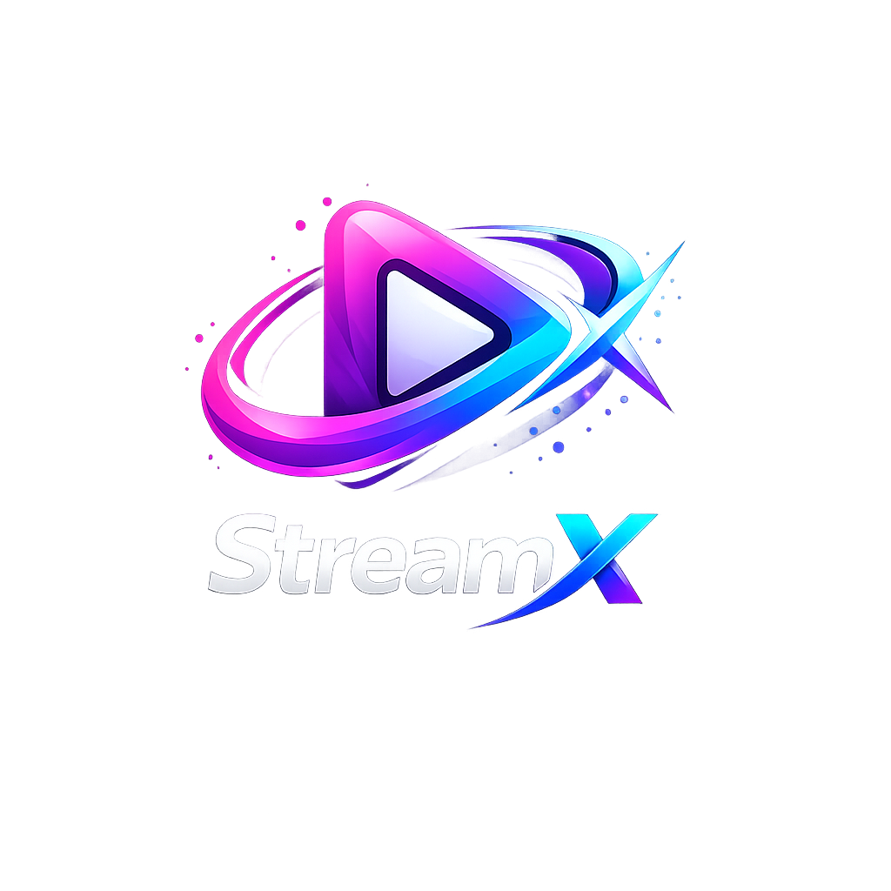

# StreamX

**A premium media player for Android TV and Google TV.** A fast, polished 10-foot interface for *your own* M3U / M3U8 playlists, Xtream Codes logins and Stalker / MAG portals. Add your playlist or provider login and StreamX turns it into a Netflix-style experience, with artwork, trailers, cast, trending lists and suggestions for every title.

> **IMPORTANT:** StreamX is a **media player only. It does not provide any content, channels or streams.** You connect the playlists and services you already have.

> **Proprietary software. All rights reserved.** StreamX is closed source and is **not** open source. Nothing in this repository, the app, its code, name, logo or artwork may be copied, cloned for reuse, redistributed, repackaged or reverse engineered. See the [Licence](LICENSE).

  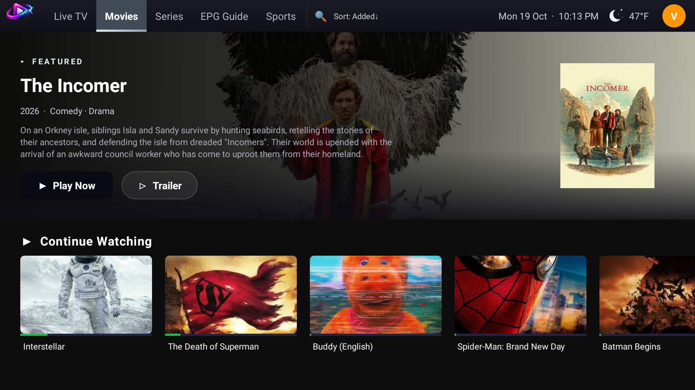
  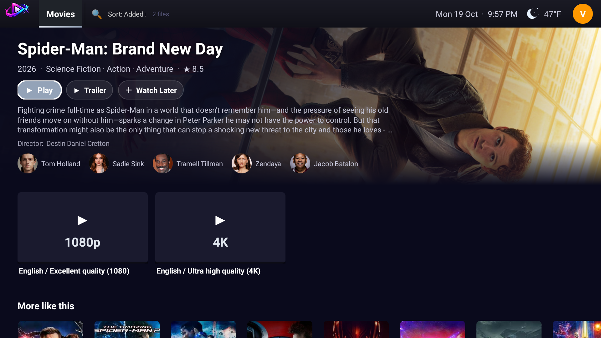

  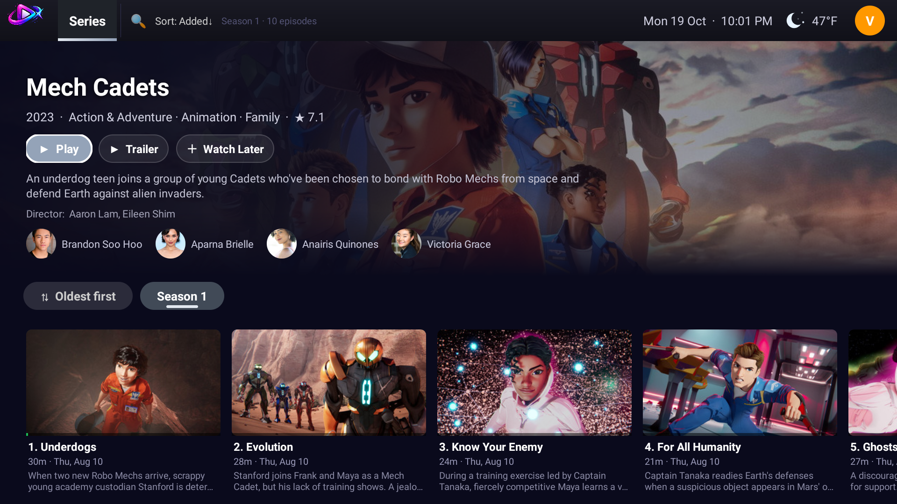
  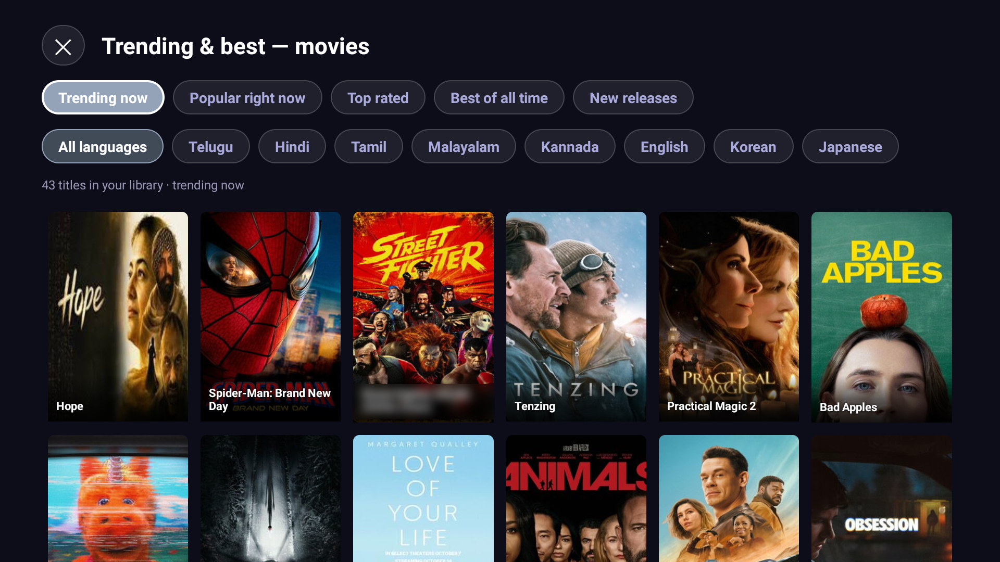

  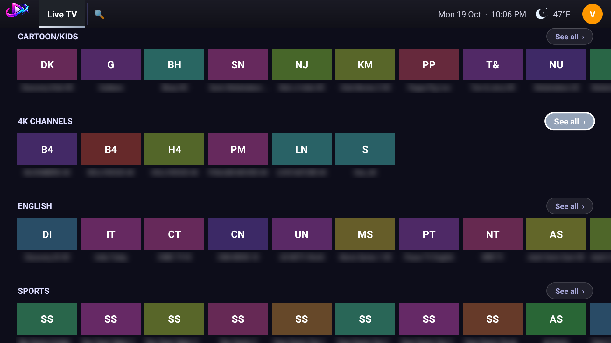
  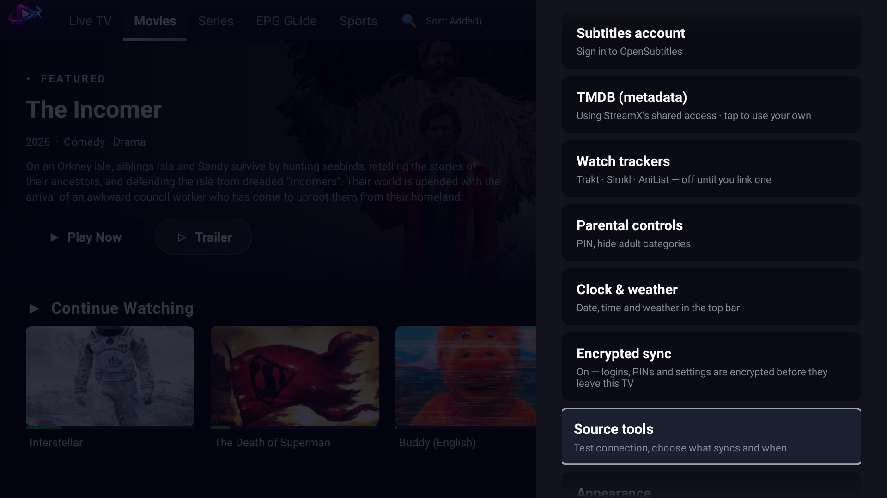

  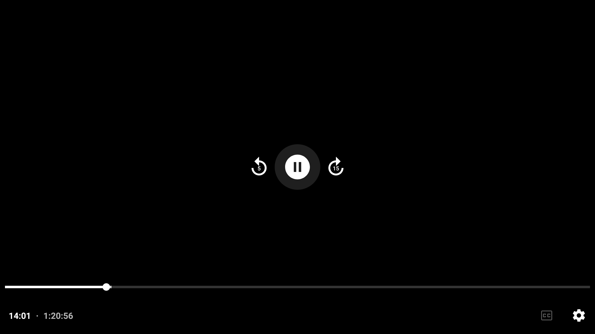
  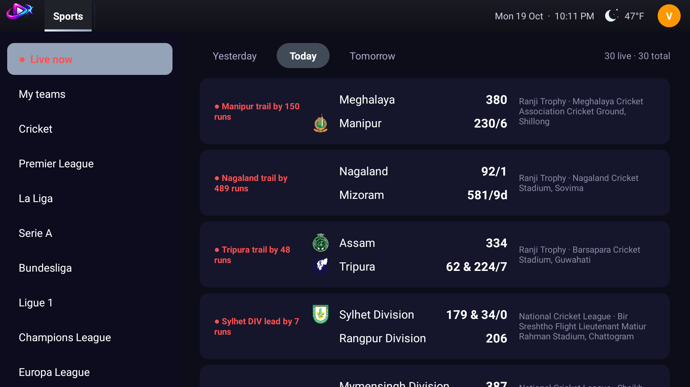

  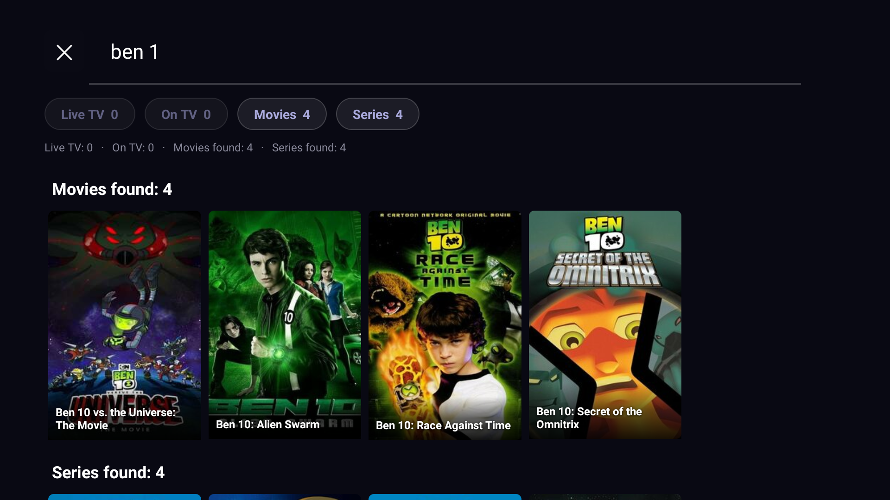
  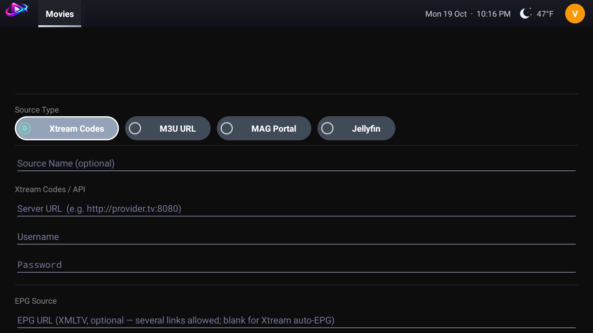

  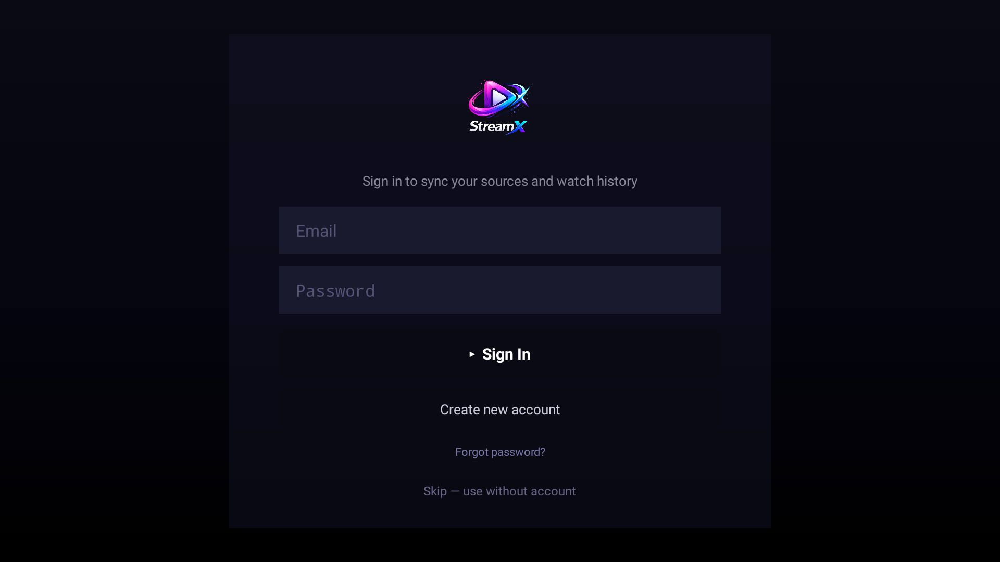
  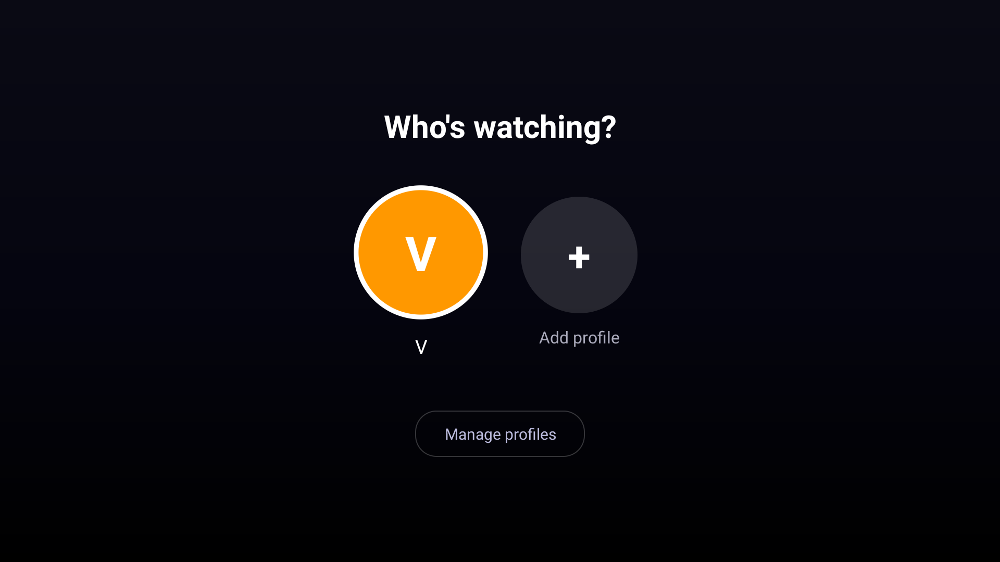

**More screenshots and full feature list:** [varunmyneni.github.io/StreamX-Public](https://varunmyneni.github.io/StreamX-Public/screenshots.html)

**New here? Start with the [Setup guide](https://varunmyneni.github.io/StreamX-Public/setup-guide-iptv-player.html)**: install, add sources, TV guide, TMDB, subtitles and trackers.

**Guides:** [Media player for Android TV](https://varunmyneni.github.io/StreamX-Public/iptv-player-android-tv.html) · [M3U playlist player](https://varunmyneni.github.io/StreamX-Public/m3u-playlist-player.html) · [Xtream Codes player](https://varunmyneni.github.io/StreamX-Public/xtream-codes-player.html) · [Stalker / MAG portal player](https://varunmyneni.github.io/StreamX-Public/stalker-mag-portal-player.html) · [EPG / XMLTV guide](https://varunmyneni.github.io/StreamX-Public/epg-xmltv-guide.html) · [Install the StreamX APK](https://varunmyneni.github.io/StreamX-Public/install-iptv-player-apk.html)

## Join the community

Updates, release notes and discussion all live on Telegram. Join the channel for news about the app, and use the discussion group linked to it to ask questions, report problems and share ideas.

  <a href="https://t.me/Stre4mX">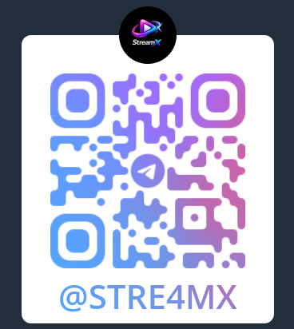</a>

**Telegram channel:** [t.me/Stre4mX](https://t.me/Stre4mX)

## Download

- **Google Play:** *(coming soon)*
- **Sideload (APK):** grab the latest `.apk` from the [Releases](https://github.com/varunmyneni/StreamX-Public/releases) page and install it on your Android TV device.

> The Play Store build and the sideload APK are signed with different keys, so pick one and stick with it. You can't update from one to the other without reinstalling.

## Features

**Playlists and streams** *(you supply these; StreamX includes none)*
- 📺 **M3U / M3U8 playlists** with extended tags, logos, groups and catch-up
- 🔑 **Xtream login** for live, movies and series with full metadata
- 📡 **Stalker / MAG portals** with automatic session handling and quality selection
- 🎞 **Jellyfin** servers *(beta)*
- Several sources side by side, with an option to combine them

**Watching**
- ▶️ Media3 / ExoPlayer engine: HLS, DASH and progressive, subtitle and audio-track selection, DRM-protected streams (Widevine and ClearKey)
- ⏯ **Continue Watching** with per-movie and per-episode resume, progress bars and watched ticks
- 🗓 **EPG** with XMLTV now/next and a live mini-player
- ⏪ **Live pause and rewind** *(beta, off by default)*
- 💬 **Subtitles** from your own OpenSubtitles account (you sign in with your own account and key; nothing is shared)
- 📈 **Watch-history trackers** *(optional)*: link your own **Trakt**, **Simkl** or **AniList** account and finished movies, episodes and anime are added to your history there. Off until you link one, and you can pause it any time
- 🔍 Instant search across live channels and the library

**Discover**
- 🔥 **Trending now** and **Best of all time**, **Popular**, **Top rated** and **New**, by language, matched to what is actually in your library
- 🎭 Cast with photos, trailers, ratings and plot for every title, from TMDB. Bring your own TMDB key if you prefer
- ✨ **More like this** that follows the film's own language, so a Telugu film suggests Telugu films
- 🏟 **Sports** tab with live scores and fixtures

**Experience**
- 🎨 Full-width rotating featured banner, configurable rows and poster grids that adapt to 720p / 1080p / 4K
- 🎮 D-pad-first navigation designed for the TV remote, with customisable remote buttons
- 👥 Separate viewing profiles with their own favourites and Watch Later, plus a parental-controls PIN
- 🌈 Accent colour presets
- ⚡ Instant startup; content refreshes silently in the background
- ☁️ Optional **encrypted cloud sync**: your sources, watch history and settings follow your account across devices. The app is fully usable without an account

## Requirements

Android TV / Google TV / Fire TV, Android 6.0 (API 23) or newer. Designed for the 10-foot / D-pad experience.

## Privacy and your data

- [Privacy Policy](https://varunmyneni.github.io/StreamX-Public/privacy-policy.html)
- [Delete your account and data](https://varunmyneni.github.io/StreamX-Public/delete-account.html). In the app: **Profile menu → Delete Account**.

StreamX is a media player only. It does not provide, host, index, bundle or resell any media, channels, streams or subscriptions. It plays only the playlists and streams you supply, and you are responsible for the content you add and its legality in your jurisdiction. All product names, logos and brands that may appear in user-supplied content are property of their respective owners.

## Licence and copyright

StreamX is proprietary software, built and maintained by its owner. **All rights reserved.**

- The app, its source code, design, name, logo, artwork and these pages are protected by copyright.
- You may install and use the official app for your own personal use. You may **not** copy, clone, mirror, fork for reuse, redistribute, resell, repackage, modify, decompile or reverse engineer the app or any part of this repository.
- The source code is private and is not part of this repository.
- Unauthorised copying or redistribution may be reported for takedown and pursued under the law.

Full terms: [LICENSE](LICENSE). To ask for permission: **5xstreamx@gmail.com**.

## Credits

This product uses the TMDB API but is not endorsed or certified by TMDB. Film and series artwork, cast and ratings come from [The Movie Database](https://www.themoviedb.org). Weather is provided by [Open-Meteo](https://open-meteo.com).

## Support

Questions or account/data-deletion requests: **5xstreamx@gmail.com**, or ask in the Telegram group linked to [t.me/Stre4mX](https://t.me/Stre4mX).

---

© 2026 StreamX. All rights reserved. StreamX is proprietary software and the application source code is not part of this repository.
